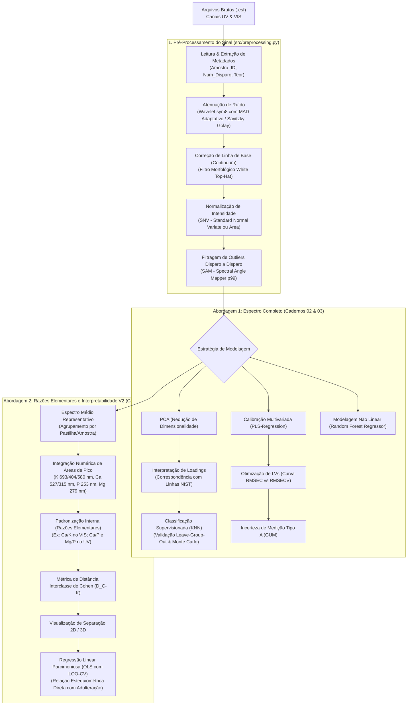

# 🔬 LIBS-NPK: Pipeline Quimiométrico e Modelagem Preditiva de Fertilizantes NPK

[](https://www.python.org/downloads/)
[](LICENSE)
[](https://www.embrapa.br/instrumentacao)

Repositório voltado ao pré-processamento de sinais espectrais, redução de dimensionalidade, modelagem quimiométrica e estimativa quantitativa de teores de adulteração em fertilizantes **NPK** utilizando **Espectroscopia de Emissão Óptica com Plasma Induzido por Laser (LIBS - *Laser-Induced Breakdown Spectroscopy*)**.

O projeto contempla dados coletados em dois canais ópticos simultâneos:
- **UV (Ultravioleta):** Faixa ~200 nm a 400 nm.
- **VIS (Visível):** Faixa ~350 nm a 800 nm.

---

## 📐 Arquitetura do Repositório

O projeto foi refatorado a partir de notebooks monolíticos originais para uma **arquitetura limpa, desacoplada e modular**, dividida em módulos Python reutilizáveis no pacote `src/` e cadernos de experimentação temáticos em `notebooks/`:

```
LIBS-NPK/
├── .gitignore                      # Exclusões para Git (escondendo .esf, binários e caches)
├── README.md                       # Documentação técnica completa
├── requirements.txt                # Dependências do projeto
│
├── data/
│   ├── README.md                   # Instruções sobre a hierarquia de pastas dos dados brutos
│   ├── raw/                        # Diretório para arquivos brutos (.esf) - ignorado no git
│   └── processed/                  # Matrizes limpas consolidadas (.parquet / .csv)
│
├── src/                            # Pacote modular com funções matemáticas e quimiométricas
│   ├── __init__.py                 # Interface pública do pacote
│   ├── preprocessing.py            # Tratamento de sinal: Wavelet, SavGol, Top-Hat, SNV, Área, SAM, .esf
│   ├── features.py                 # Áreas de pico, razões atômicas (Ca/K, Ca/P), Cohen's d (D_C-K), NIST
│   ├── models.py                   # PCA, KNN, PLSR (LVs, incerteza Tipo A), Random Forest, LOGO-CV
│   └── visualization.py            # Gráficos padronizados: espectros médios, loadings com NIST, calibração
│
└── notebooks/                      # Cadernos Jupyter desacoplados por etapa analítica
    ├── 01_eda_e_preprocessamento.ipynb       # Leitura .esf, filtros de ruído/baseline, SNV e corte SAM
    ├── 02_pca_e_classificacao_knn.ipynb      # PCA nos canais UV/VIS, NIST Loadings e KNN com LOGO-CV
    ├── 03_regressao_quimiometrica_pls_rf.ipynb # PLS-Regression (RMSEC/RMSECV), incerteza Tipo A e Random Forest
    └── 04_razoes_elementares_v2.ipynb        # Abordagem V2: Espectro representativo, razões Ca/K, D_C-K e OLS
```

---

## 🔄 Fluxograma do Pipeline Quimiométrico



---

## 🧪 Fundamentação dos Métodos Matemáticos

### 1. Remoção de Ruído com Wavelet Adaptativa
Para atenuar ruído de alta frequência sem alargar os picos estreitos de emissão atômica, emprega-se a **Transformada Wavelet Discreta (DWT)** utilizando a família Symlet 8 (`sym8`). O desvio padrão do ruído ($\sigma$) é estimado pelo estimador robusto **MAD (Median Absolute Deviation)** sobre os coeficientes de detalhe do nível mais fino ($cD_1$), conforme Donoho & Johnstone (1994):

$$\sigma = \frac{1}{0.6745} \text{mediana}\left(|cD_1 - \text{mediana}(cD_1)|\right)$$

O limiar universal calculado é:

$$\lambda = \sigma \sqrt{2 \ln(N)}$$

### 2. Remoção de Fundo com White Top-Hat
O plasma gerado em LIBS produz uma forte radiação de fundo contínuo (emissão *bremsstrahlung* e recombinação iônica). O operador morfológico **White Top-Hat** realiza a subtração da abertura morfológica:

$$S_{\text{corrigido}} = S - (S \circ B)$$

onde $B$ é um elemento estruturante plano (vetor de uns de dimensão 100). Isso achata a linha de base mantendo intactas as alturas relativas dos picos analíticos.

### 3. Normalização Espectral (SNV & Área)
- **Standard Normal Variate (SNV):** Corrige variações globais de ganho físico e espalhamento causadas por rugosidade superficial e flutuações de energia pulso-a-pulso do laser:
  $$x_{\text{SNV}} = \frac{x - \mu}{\sigma}$$
- **Normalização por Área:** Calcula a integral numérica de Simpson sobre todo o espectro e divide as intensidades pela área total ($\int x(\lambda) d\lambda = 1$).

### 4. Filtragem de Outliers via Spectral Angle Mapper (SAM)
Em matrizes granulares como fertilizantes NPK, disparos individuais podem atingir vazios ou sofrer quebra deficiente do plasma. O algoritmo SAM compara o vetor espectral de cada disparo $\mathbf{x}_i$ com o vetor médio da pastilha $\bar{\mathbf{x}}$:

$$\theta_i = \arccos\left( \frac{\mathbf{x}_i \cdot \bar{\mathbf{x}}}{\|\mathbf{x}_i\| \|\bar{\mathbf{x}}\|} \right)$$

Disparos cujo ângulo $\theta_i$ supera o percentil 99 do grupo são descartados automaticamente.

### 5. Prevenção de Vazamento de Dados (*Data Leakage*)
> [!IMPORTANT]
> Em espectroscopia LIBS, múltiplos disparos são adquiridos na mesma pastilha prensada. Se disparos da mesma pastilha forem distribuídos aleatoriamente entre treino e teste, o modelo decora micro-heterogeneidades da amostra, gerando **acurácias artificialmente infladas**.
> 
> Neste repositório, todas as validações utilizam:
> - **Leave-One-Group-Out CV (LOGO-CV)** agrupado por pastilha (`Amostra_ID`);
> - Ou agregação prévia no **Espectro Médio Representativo** (Abordagem V2).

### 6. Padronização Interna e Métrica de Cohen ($D_{C-K}$)
Na abordagem V2, o elemento adicionado como adulterante (por exemplo, fontes ricas em Cálcio ou calcário) é monitorado em relação à matriz genuína de Potássio (K) ou Fósforo (P).  
A distância de Cohen ($D_{C-K}$) avalia a capacidade discriminante de cada razão elementar:

$$D_{C-K} = \frac{|\mu_{\text{puro}} - \mu_{\text{adulterado}}|}{s_{\text{pooled}}}$$

$$s_{\text{pooled}} = \sqrt{\frac{(n_p - 1)s_p^2 + (n_a - 1)s_a^2}{n_p + n_a - 2}}$$


## 👥 Autoria e Agradecimentos

- **Desenvolvimento e Pesquisa:** Embrapa Instrumentação (São Carlos - SP)
- **Aplicações:** Controle de qualidade analítica, fiscalização de insumos agrícolas e detecção de adulteração em fertilizantes NPK.
